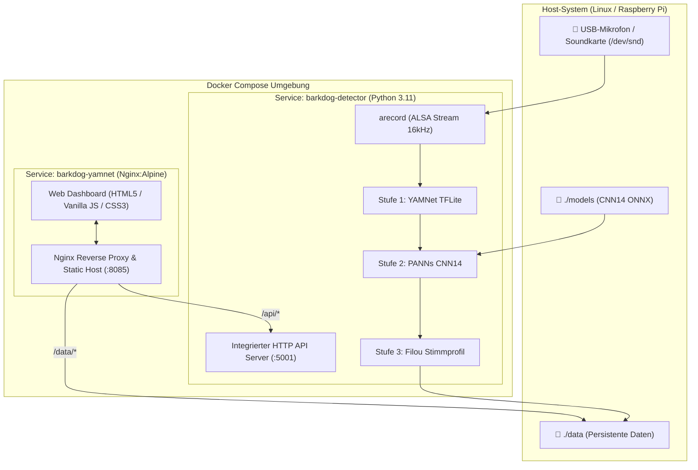

# 🐕 BarkDog Filou

> **24/7 Smart Dog Bark Monitoring & Multi-Stage Acoustic AI**  
> Ein autarkes, lokales Audio-Überwachungssystem zur präzisen Erkennung, Analyse und Protokollierung von Hundegebell in Echtzeit – optimiert für Linux-Homeserver und den Raspberry Pi.

[](#installation--schnellstart)
[](#technologie-stack)
[](#technologie-stack)
[](LICENSE)
[](#datenschutz--datensouveränität)

---

## 📋 Inhaltsverzeichnis

- [Überblick](#-überblick)
- [Die 3-Stufen Audio-KI](#-die-3-stufen-audio-ki)
- [Kernfunktionen & Web-Dashboard](#-kernfunktionen--web-dashboard)
- [Systemarchitektur](#-systemarchitektur)
- [Systemvoraussetzungen](#-systemvoraussetzungen)
- [Installation & Schnellstart](#-installation--schnellstart)
- [Projekt- und Ordnerstruktur](#-projekt--und-ordnerstruktur)
- [REST-API Dokumentation](#-rest-api-dokumentation)
- [Konfiguration & Umgebungsvariablen](#-konfiguration--umgebungsvariablen)
- [Datenschutz & Datensouveränität](#-datenschutz--datensouveränität)
- [Lizenz & Danksagung](#-lizenz--danksagung)

---

## 🔍 Überblick

**BarkDog Filou** überwacht akustisch Wohnräume oder Außenbereiche, erkennt Hundegebell zuverlässig und filtert Fehlalarme (z.B. Fernseher, Küchengeräusche, Husten, Türklingeln) durch eine mehrstufige kaskadierte KI-Pipeline heraus.

Das System läuft **100% lokal** in schlanken Docker-Containern:
- **Keine Cloud-Abhängigkeit:** Audiodaten verlassen niemals das lokale Netzwerk.
- **Keine externen CDNs:** Sämtliche Web-Bibliotheken, Fonts und Icons werden physisch ausgeliefert.
- **Ressourcenschonend:** Kontinuierliches Audio-Streaming mit minimaler CPU-Last (~1–2% auf modernen ARM/x86-Systemen), während schwere Klassifizierungsmodelle nur ereignisgesteuert aktiv werden.

---

## 🧠 Die 3-Stufen Audio-KI

Die Erkennung basiert auf drei intelligent ineinandergreifenden Verarbeitungsstufen:

```
[ Mikrofon-Stream (ALSA 16 kHz) ]
               │
               ▼
   ┌───────────────────────┐
   │  Stufe 1: YAMNet      │ ──> Kein Bellen ──> Verwerfen (keine CPU-Last)
   │  (Echtzeit-Vorfilter) │
   └───────────────────────┘
               │ Bellen vermutet
               ▼
   ┌───────────────────────┐
   │  Stufe 2: CNN14 ONNX  │ ──> Score < Schwelle ──> In den Papierkorb (Trash)
   │  (Präzisions-Verifier)│
   └───────────────────────┘
               │ Bestätigt
               ▼
   ┌───────────────────────┐
   │  Stufe 3: Filou-KI    │ ──> Cosine Similarity gegen 96D-Stimmprofil
   │  (Personalisiert)     │     • Filou-Stimme erkannt (≥70%): Boost + Badge 🎯
   └───────────────────────┘     • Typischer Fehlalarm (≥85%): Verwerfen
               │
               ▼
   [ Ereignis-Protokoll & Audio-Clip gespeichert ]
```

### 1. Stufe 1: YAMNet TFLite (24/7 Echtzeit-Vorfilter)
- Erfasst kontinuierlich Audiodaten über das ALSA-Subsystem (`arecord`, 16.000 Hz, 16-Bit Mono).
- YAMNet (MobileNet-basiert) analysiert Audiorahmen in Sekundenbruchteilen bei minimalem Ressourcenverbrauch.
- Identifiziert typische Bell-Klassen (`Bark`, `Yip`, `Howl`, `Bow-wow`, `Growling`).

### 2. Stufe 2: PANNs CNN14 ONNX (Präzisions-Klassifizierer)
- Sobald Stufe 1 anschlägt, übernimmt der Hintergrund-Worker die Auswertung über **PANNs CNN14** (AudioSet-Tagging-Modell mit 527 Klassen).
- Berechnet die exakte Bell-Konfidenz (`Dog`, `Bark`, `Yip`, `Howl`) und filtert komplexe Fehlalarme aus.
- Messung der exakten Inferenzzeit (wird im Protokoll als Badge visualisiert, z.B. `⚡ 1.18s`).
- Schwellenwert über das Dashboard dynamisch regelbar (Default: `45%`).

### 3. Stufe 3: Filou KI-Trainer (Personalisiertes Stimmprofil & Active Learning)
- Bildet für jede Aufnahme einen **96-dimensionalen akustischen Merkmalsfingerabdruck** (32 Frequenzbänder via FFT, 32 zeitliche Hüllkurven-Abschnitte, 32 CNN14-Wahrscheinlichkeiten).
- Über die Weboberfläche können Clips mit einem Klick als *"Ja (Filou)"* oder *"Nein (Fehlalarm)"* bewertet werden.
- Abgleich via **Cosine Similarity**:
  - **Stimm-Boost:** Ähnlichkeit zu Filous Stimme (≥ 70%) bestätigt auch leisere oder atypische Beller.
  - **Fehlalarm-Dämpfung:** Ähnlichkeit zu gelernten Störgeräuschen (≥ 85%) verhindert Falschmeldungen zuverlässig.

---

## 🎛️ Kernfunktionen & Web-Dashboard

- **Echtzeit-Audiopegel & Status-Anzeige:**
  - Live-VU-Meter mit Lautstärkepegel in dBFS.
  - Dynamischer Gerätestatus (`Aufnahme aktiv`, `Pausiert`, `Fehler`).

- **Episoden-Gruppierung (Bell-Serien $\le$ 60s):**
  - Hunde bellen selten isoliert – Single-Linkage Clustering fasst aufeinanderfolgende Beller innerhalb eines 60-Sekunden-Fensters zu zusammenhängenden Episoden zusammen.
  - Master-Detail-Ansicht: Gesamtzeitbereich, Beller-Anzahl, Maximal-/Durchschnittswerte und aufklappbare Einzel-Clips mit Delta-Zeiten (`+16s`).
  - **Serien-Playlist-Player:** Spielt alle Clips einer Bell-Serie chronologisch hintereinander ab, inklusive automatischer Server-Mikrofonpausierung gegen Rückkopplungen.

- **Interaktive Aktivitätsdiagramme (24h- & Wochenansicht):**
  - 24-Stunden-Balkendiagramm mit automatischer Zentrierung auf die Spitzenstunde.
  - **Mobiles Touch-Scrolling:** Optimiert für Smartphones mit horizontalem Wisch-Container (`640px` Mindestbreite) und daumenfreundlichen Touch-Overlays.
  - 4 integrierte Mini-KPIs (Beller im Zeitraum, Aktivste Phase, Ruhigste Phase / Schnitt, Höchste Konfidenz).

- **Integrierter Filou KI-Trainer:**
  - Schnelles Active Learning Modal mit Tastaturbedienung (`J`/`→` = Ja, `N`/`←` = Nein, `Leertaste` = Play/Pause).
  - **Live KI-Vorhersage:** Das Modell zeigt vor der Entscheidung seine eigene Tendenz an (`🤖 KI-Vorhersage: Filou (89.5%)` oder `Fehlalarm`), wodurch der Lernfortschritt sofort erlebbar wird.
  - **Modell-Reifegrad:** Visualisierung des Erfahrungslevels (Level 1: Basis → Level 4: Profi-Stimmprofil) mit Trennschärfe-Score und Tagesverlaufskurve.
  - **Endlosschleife & Feedback-Schutz:** Clips laufen im Loop; das Server-Mikrofon wird während des Trainings temporär stummgeschaltet, damit keine Audio-Rückkopplungen entstehen.

- **Globale Server-Persistenz:**
  - Der CNN14-Schwellenwert-Slider wird zentral in `data/settings.json` gespeichert. Alle verbundenen Geräte (Smartphone, Tablet, Desktop) greifen synchron auf dieselbe Konfiguration zu.

- **Vollständiger Datenexport & Papierkorb:**
  - CSV-Export mit Datumsfilter, Konfidenzen und Serien-Nummern.
  - 20-Clip-Papierkorb zum Wiederherstellen oder Nachbewerten verworfener Geräusche.

---

## 🏗️ Systemarchitektur

Das Gesamtsystem besteht aus zwei eng abgestimmten Services im Docker-Netzwerk:



---

## 💻 Technologie-Stack

| Komponente | Technologie | Details |
|---|---|---|
| **Audio-Erfassung** | ALSA (`arecord`) | 16 kHz Mono, 16-Bit PCM |
| **Vorfilter (Stufe 1)** | TensorFlow Lite | `yamnet.tflite` (AudioSet-Subset, 4 MB) |
| **Verifier (Stufe 2)** | ONNX Runtime | `panns_cnn14.onnx` (AudioSet 527 Klassen, ~312 MB) |
| **Active Learning** | Python / NumPy | 96D Feature-Vektor (FFT + Envelope + CNN14) & Cosine Similarity |
| **Backend & API** | Python 3.11 (`http.server`) | Integrierter Multithreaded REST-API Server |
| **Frontend** | Vanilla JS & CSS3 | Single-Page Application, Responsive Card-/Table-Layout, Local-First |
| **Webserver / Proxy** | Nginx Alpine | Caching statischer Assets, Reverse Proxy für API & Media Streaming |
| **Containerisierung** | Docker & Docker Compose | Multi-Container Architektur mit ALSA Hardware-Passthrough |

---

## ⚙️ Systemvoraussetzungen

- **Betriebssystem:** Linux (Debian, Ubuntu, Raspberry Pi OS, etc.)
- **Hardware:**
  - x86_64 oder ARM64 (z.B. Raspberry Pi 4 / 5 ab 2 GB RAM empfohlen)
  - USB-Mikrofon oder USB-Soundkarte
- **Software:**
  - Docker & Docker Compose Plugin (`docker compose`)
  - Git
  - `curl` oder `wget` (für den Modell-Download)

---

## 🚀 Installation & Schnellstart

### 1. Repository klonen

```bash
git clone https://github.com/Schmitt-A/BarkDog.git
cd BarkDog
```

### 2. Machine Learning Modell herunterladen

Das PANNs CNN14-Modell (~312 MB) wird über das bereitgestellte Skript automatisch von Hugging Face bezogen und per SHA-256 verifiziert:

```bash
chmod +x download_models.sh
./download_models.sh
```

### 3. Audiogerät identifizieren

Prüfe, ob das Mikrofon vom ALSA-Subsystem erkannt wird:

```bash
arecord -l
```

*Beispielausgabe:*
```text
**** Liste der Hardware-Geräte (CAPTURE) ****
Karte 1: Device [USB Audio Device], Gerät 0: USB Audio [USB Audio]
```

> **Hinweis zu Rechten:** Stelle sicher, dass dein Benutzer und der Docker-Dienst Zugriff auf `/dev/snd` haben (`sudo usermod -aG audio $USER`).

### 4. Container bauen und starten

Starte die Services im Hintergrund:

```bash
docker compose up -d --build
```

### 5. Dashboard aufrufen

Öffne den Browser deiner Wahl unter:
```text
http://<SERVER-IP>:8085
```

---

## 📁 Projekt- und Ordnerstruktur

```text
BarkDog/
├── .ai/                          # Architektur-Entscheidungen (ADRs) & Gedächtnissystem
│   ├── rules.md                  # Architektur- & Tech-Stack-Regeln
│   ├── memory.md                 # Langzeitgedächtnis & ADR-Protokolle
│   └── current-task.md           # Arbeitsgedächtnis & Task-Status
├── data/                         # Persistente Laufzeitdaten (in .gitignore)
│   ├── settings.example.json     # Konfigurationsvorlage
│   ├── recordings/               # Gespeicherte .wav Audio-Clips
│   ├── dataset/                  # Gelabelte Trainingsdaten (barks/ und noise/)
│   ├── events.json               # Protokollierte Bell-Ereignisse
│   ├── trash.json                # Papierkorb für verworfene Clips
│   ├── status.json               # Live-Status & Audiopegel
│   └── filou_profile.json        # Gelerntes 96D-Stimmprofil
├── models/                       # KI-Modelle für Stufe 2
│   ├── .gitkeep
│   ├── class_labels_indices.csv  # AudioSet Klassen-Zuordnungen
│   └── panns_cnn14.onnx          # CNN14 Gewichte (via download_models.sh)
├── public/                       # Frontend Web-Applikation
│   ├── index.html                # Dashboard & UI-Markup
│   ├── style.css                 # Responsive Layout & Dark-Mode Design
│   ├── app.js                    # UI-Logik, Polling, Diagramme & Trainer
│   ├── audio-processor.js        # Web Audio API Helfer
│   ├── sample-bark.wav           # Audio-Referenzsample
│   ├── libs/                     # Lokale JavaScript-Bibliotheken (TF.js, YAMNet)
│   └── model/                    # Clientseitige Web-Modell-Gewichte
├── detector.py                   # 24/7 Python Audio-Erfassung & REST-API
├── re_evaluate_history.py        # Migrations- & Neubewertungs-Skript
├── download_models.sh            # Automatisierter Modell-Download mit Checksum-Prüfung
├── Dockerfile                    # Nginx Alpine Container für das Web-Dashboard
├── Dockerfile.detector           # Python 3.11 Container mit ALSA, TFLite & ONNX
├── docker-compose.yml            # Multi-Container Orchestrierung
├── nginx.conf                    # Nginx Reverse Proxy & MIME-Konfiguration
├── yamnet.tflite                 # Stufe 1 YAMNet Modellgewichte
└── README.md                     # Projektdokumentation
```

---

## 📡 REST-API Dokumentation

Der Hintergrund-Daemon (`detector.py`) exponiert eine schlanke REST-API über Port `5001` (im Nginx-Proxy erreichbar unter `/api/`):

| Endpunkt | Methode | Beschreibung |
|---|---|---|
| `/api/status` | `GET` | Liefert Gerätezustand, aktuellen Audiopegel (dBFS), Erkennungszähler und Pause-Status |
| `/api/events` | `GET` | Liefert alle bestätigten Bell-Ereignisse |
| `/api/events/<filename>` | `DELETE` | Löscht ein Ereignis und verschiebt die Audiodatei in den Papierkorb |
| `/api/settings` | `GET` | Ruft server-persistierte Einstellungen (CNN14-Schwelle etc.) ab |
| `/api/settings` | `POST` | Aktualisiert globale Schwellenwerte atomar in `settings.json` |
| `/api/pause` | `POST` | Pausiert die Audio-Erfassung temporär (z.B. `{"duration": 120.0}`) |
| `/api/resume` | `POST` | Beendet eine aktive Pause sofort und nimmt die Erfassung wieder auf |
| `/api/trash` | `GET` | Listet alle Clips im 20-Clip-Papierkorb auf |
| `/api/restore` | `POST` | Stellt einen Clip aus dem Papierkorb wieder in das Protokoll her |
| `/api/trainer/queue` | `GET` | Liefert unbewertete Clips für das Stufe-3 Active Learning inkl. Live-Vorhersage |
| `/api/trainer/label` | `POST` | Speichert Nutzer-Feedback (`bark` / `noise`) und aktualisiert das Stimmprofil |
| `/api/trainer/stats` | `GET` | Liefert Modell-Reifegrad, Zuverlässigkeits-Score und historische Lernkurve |

---

## 🔧 Konfiguration & Umgebungsvariablen

In `docker-compose.yml` können Umgebungsvariablen angepasst werden:

```yaml
services:
  barkdog-detector:
    environment:
      - TZ=Europe/Berlin                  # Zeitzone für korrekte Zeitstempel
      - SENSITIVITY=0.25                  # YAMNet Vorfilter-Empfindlichkeit (0.0 - 1.0)
      - CNN14_CONFIRM_THRESHOLD=0.20      # Initiale CNN14 Mindestschwelle
      - MODEL_PATH=/app/yamnet.tflite     # Pfad zum YAMNet TFLite Modell
      - CNN14_MODEL_PATH=/app/models/panns_cnn14.onnx
```

---

## 🔒 Datenschutz & Datensouveränität

1. **Keine Audio-Übertragung ins Internet:** Alle Berechnungen laufen auf der lokalen CPU/NPU. Es werden zu keinem Zeitpunkt Audio-Streamings oder Audioschnipsel an Cloud-Dienste übertragen.
2. **Datenschutzkonforme Git-Historie:** Private Aufnahmen (`data/recordings/`), Stimmprofile (`filou_profile.json`) und historische Protokolle (`events.json`) sind in `.gitignore` eingetragen und werden niemals in öffentliche Repositories hochgeladen.

---

## 📄 Lizenz & Danksagung

Dieses Projekt ist unter der **MIT-Lizenz** lizenziert.

### Danksagung & Open-Source-Referenzen:
- [Google Research YAMNet](https://github.com/tensorflow/models/tree/master/research/audioset/yamnet) für das vortrainierte Audio-Ereignis-Erkennungsmodell.
- [PANNs (Large-Scale Pretrained Audio Neural Networks)](https://github.com/qiuqiangkong/audioset_tagging_cnn) von Qiuqiang Kong et al. für das vortrainierte CNN14 AudioSet-Modell.
- [TensorFlow Lite](https://www.tensorflow.org/lite) und [ONNX Runtime](https://onnxruntime.ai/) für die performante Inferenz auf Embedded-Hardware.
